<div align="center">

# 微光 WeiGuang · 社区邻里互助平台

**让不会用手机的独居老人，也能一键喊到邻居**

[](https://openjdk.org/)
[](https://spring.io/projects/spring-boot)
[](https://www.mysql.com/)
[](https://redis.io/)
[](https://vuejs.org/)
[](https://uniapp.dcloud.net.cn/)
[](postman/微光-API接口测试.postman_collection.json)

**接口自动化测试：145 个请求 · 523 条断言 · 100% 通过（0 失败）**

[测试报告](docs/接口测试报告.html) · [测试集合](postman/微光-API接口测试.postman_collection.json) · [详细设计文档](docs/design/详细设计文档.md) · [运行说明](postman/README.md)

</div>

---

## 项目简介

「微光」是一款面向社区独居老人的邻里互助微信小程序：老人用一句话发布一件小事（跑腿、维修、陪伴、远程帮忙……），邻居接单上门或线上协助，双向确认后完成结算，并获得微光值与荣誉积分。

项目采用**模块化单体**架构，包含微信小程序端、Web 管理后台与 AI 助手，后端提供 **105 个 REST 接口**、26 张数据表、31 个小程序页面。

> 个人独立项目：从需求拆解、表结构设计、核心业务实现，到**接口自动化测试体系与测试报告**，均由本人完成。

## 测试工作亮点（软件测试视角）

本仓库除业务功能外，重点沉淀了一套**可复现的接口自动化测试工程**，体现接口测试 / 功能测试的完整工作方法。

| 指标 | 数值 |
| :--- | :--- |
| 被测后端接口 | 105 个 |
| 自动化测试请求 | **145 个** |
| 断言 | **523 条** |
| 通过率 | **100%（0 失败）** |
| 覆盖模块 | 19 个 |
| 测试定位并推动修复的缺陷 | 11 处 |
| Testcontainers 集成测试 | 7 类 / 8 条用例 |
| 数据不变量自检 | 24 条 |
| 全量执行耗时 | ≈ 15s，平均响应 21ms |

**覆盖范围**：认证鉴权、用户资料、地址、邻居、求助订单全生命周期与状态机、聊天、社区、通知、申诉/反馈、激励与荣誉、AI 助手、文件上传、管理端等。

### 测试用例设计方法
- **等价类划分 / 边界值**：标题长度、内容长度、标签数量、分页参数、年龄与信用门槛等边界与越界校验；
- **场景法**：串起主链路「发布 → 接单 → 开始 → 完成 → 双向确认 → 结算」，验证端到端业务正确性；
- **状态迁移法**：覆盖 `PENDING → ACCEPTED → IN_SERVICE → PENDING_CONFIRM → COMPLETED` 及取消、过期、申诉等异常分支；
- **异常与越权**：未登录、Token 失效、越权操作、重复提交、并发接单等负向用例。

### 断言规范（关键实践）
- **HTTP 状态码 ≠ 业务结果**：本系统业务错误统一返回 HTTP 200，成败以响应体 `code` 为准（`0` 成功，`10001` 参数校验失败、`20001` 未登录、`30003` 待响应达上限、`40002` 状态不允许……），每条用例都断言 `body.code` 与关键字段；
- 校验核心字段类型/非空、状态值与响应耗时，避免「接口通但业务错」；
- 测试过程中识别并修正了「期望值写错导致假绿（false positive）」的用例——**测试通过 ≠ 测对了**。

### 缺陷发现示例（测试中定位并推动修复）
| 场景 | 问题 |
| :--- | :--- |
| 取消订单 | 取消模式传 `DIRECT` 被拒（契约应为 `CANCEL / NEGOTIATE`） |
| 照护提示 | 在已完成订单上仍被允许 / 错误码与状态限制不符 |
| 待响应上限 | 配置 `order.pending_limit` 未在链路中生效 |
| 重复接单 | 已成交订单再次被接单，应返回 `40001` 冲突 |

### 如何复现测试结果
```bash
# 1) 启动 MySQL / Redis / 后端（详见「快速开始」）
# 2) 安装命令行执行器
npm install -g newman
# 3) 执行集合（含「00 初始化」：抬高限流、登录并注入 token）
newman run "postman/微光-API接口测试.postman_collection.json" \
  -e "postman/微光-本地.postman_environment.json" \
  --timeout-request 15000 \
  --reporters cli,json --reporter-json-export newman-report.json
```
> 测试集按文件夹编号顺序执行，存在变量/状态依赖，请整体按序运行。集合由 `postman/tools/build.mjs` 生成（唯一权威来源，改用例请改脚本后 `node postman/tools/build.mjs` 重新生成）。

## 功能与界面

### 普通模式
| | | |
| :---: | :---: | :---: |
| 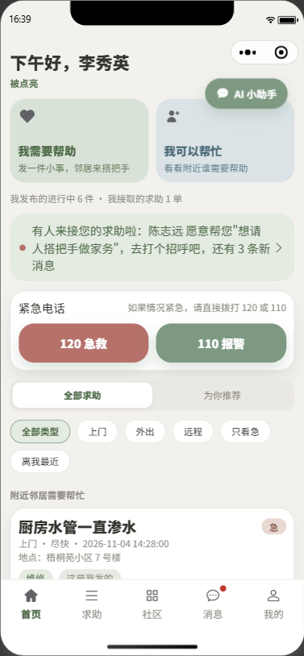<br>首页 | 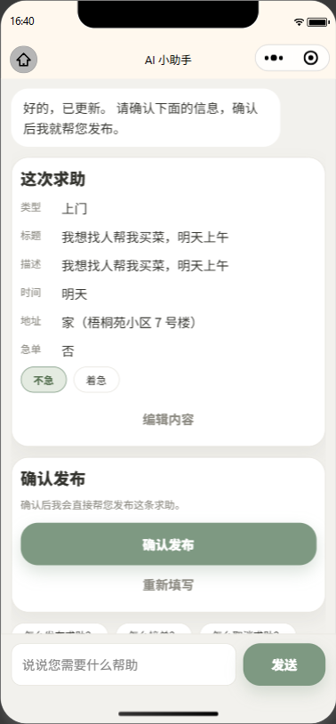<br>AI 助手 · 一句话补齐并确认发布 | 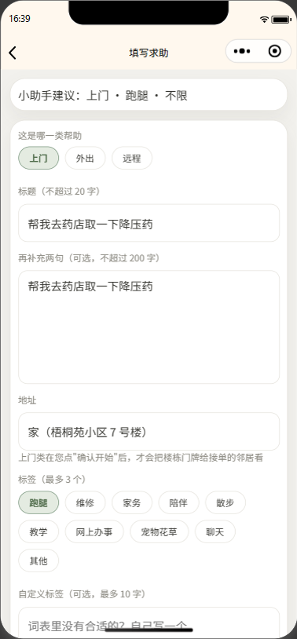<br>发布 · 小助手自动归类 |
| 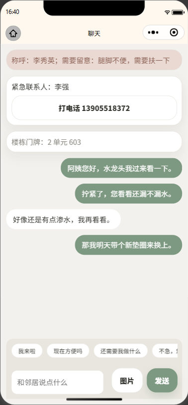<br>聊天 · 照护提示与门牌解锁 | 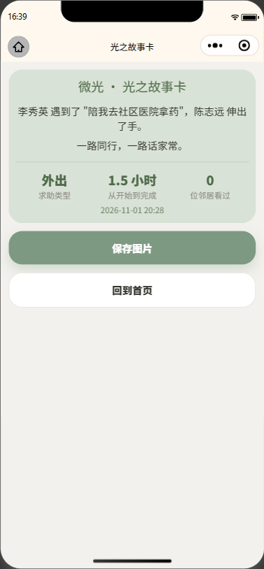<br>完成 · 光之故事卡 | 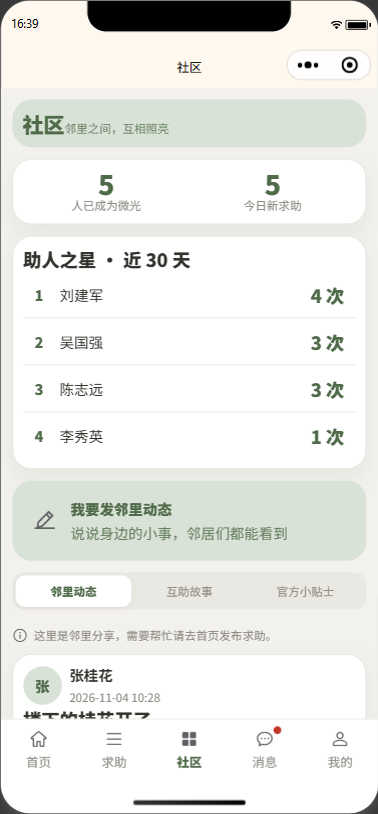<br>社区 · 荣耀榜与邻里动态 |

### 年长模式
> 同一套业务：字号与按钮放大、非必要元素隐藏、动效默认关闭。

| | | |
| :---: | :---: | :---: |
| 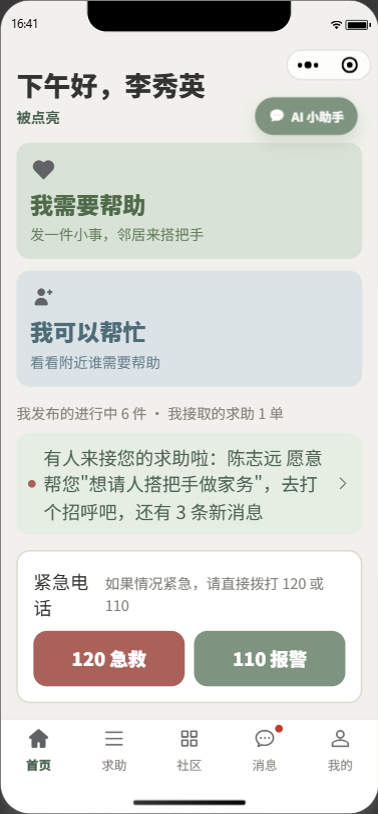<br>首页 · 单列大字卡片 | 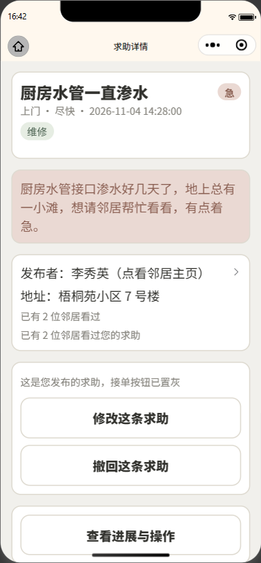<br>求助详情 · 大字号操作 | 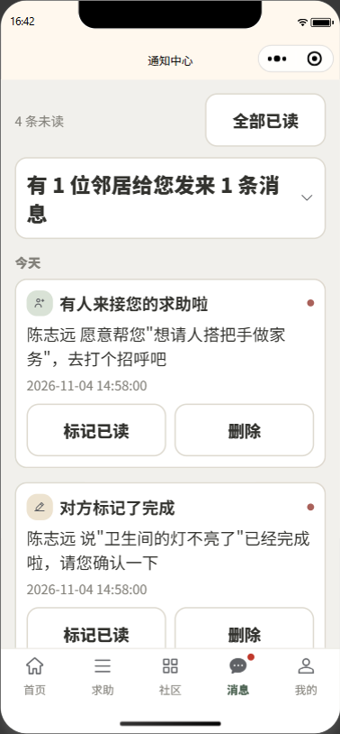<br>通知中心 · 分组与已读 |

### 管理端
| | |
| :---: | :---: |
| 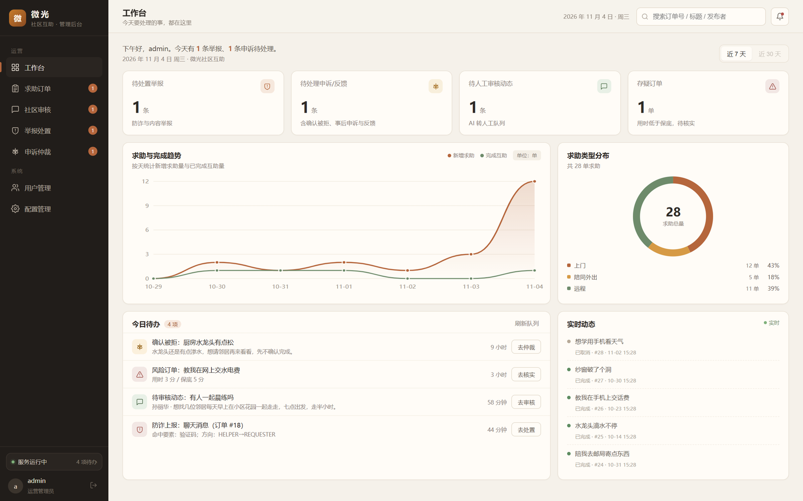<br>工作台 · KPI / 趋势 / 待办 | 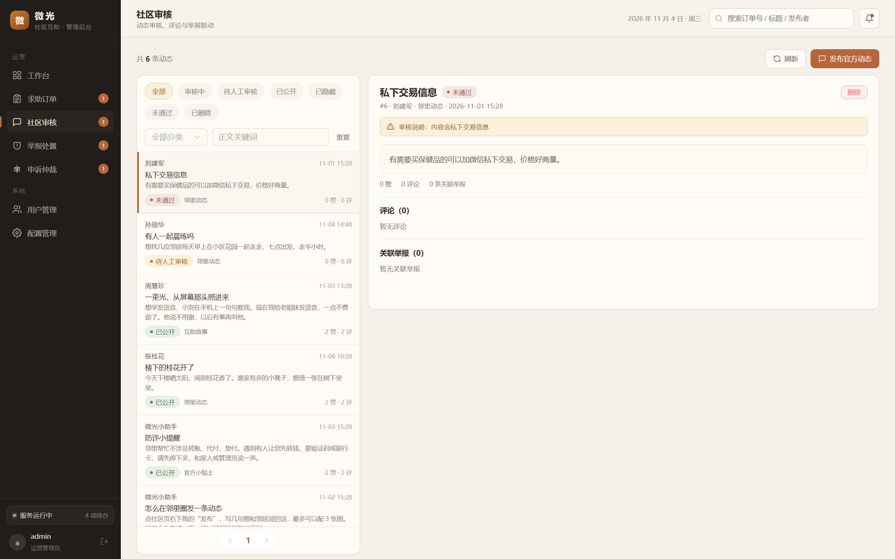<br>社区审核 · AI 初审 + 人工复核 |

## 技术栈

| 层次 | 技术 |
| :--- | :--- |
| 后端 | Java 17、Spring Boot 3.5、MyBatis-Plus、JWT、WebSocket、Spring AI Alibaba（通义千问） |
| 数据 | MySQL 8.4、Redis 7.4（限流 / 缓存 / 一次性令牌） |
| 前端 | Vue 3、Element Plus（管理后台）；uni-app + Vue 3（微信小程序） |
| 测试 | Postman + Newman（接口自动化）、JUnit 5 + Testcontainers（集成测试） |
| 工程 | Docker Compose、Maven、Vite |

## 架构

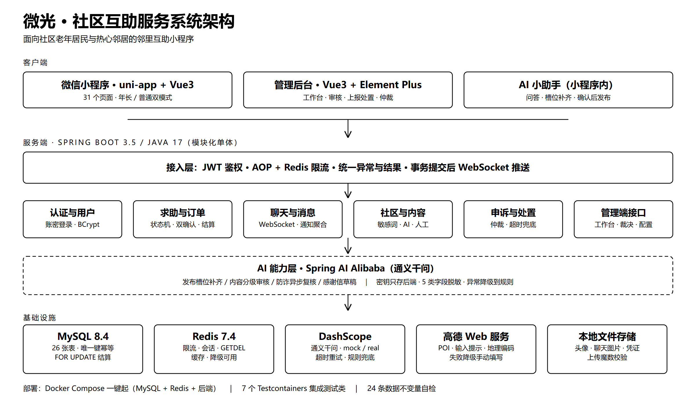

模块化单体：`backend/` 按业务域拆包（认证、订单、聊天、社区、申诉、管理端），AI 能力以独立层内嵌；密钥只存后端 `.env`，不下发前端。

## 快速开始

**环境**：JDK 17+、Maven 3.8+、Node 18+、Docker Desktop、微信开发者工具

```powershell
# 1) 中间件与数据库
cd backend
copy .env.example .env          # 按注释填写连接与密钥（.env 不进仓库）
docker compose up -d mysql redis   # MySQL 8.4 / Redis 7.4

# 2) 建表 + 演示数据（仓库根目录执行，规避 Windows 管道中文乱码）
docker cp sql\schema.sql weiguang-mysql:/tmp/schema.sql
docker exec -i weiguang-mysql mysql --default-character-set=utf8mb4 -uroot -p weiguang -e "source /tmp/schema.sql"
powershell -ExecutionPolicy Bypass -File scripts\demo-reset.ps1

# 3) 启后端
cd backend
mvn spring-boot:run

# 4) 小程序（另开终端）
cd front/miniapp && npm install && npm run dev:mp-weixin
# 微信开发者工具导入 front/miniapp/dist/dev/mp-weixin

# 5) 管理后台（另开终端）
cd admin-web && npm install && npm run dev      # http://localhost:5174
```

- 健康检查：`http://localhost:8080/actuator/health`　·　接口文档：`http://localhost:8080/swagger-ui.html`
- 集成测试：`mvn "-Dtest=OrderFullFlowTest,AcceptConcurrencyTest,PointConcurrencyTest,ConfirmRejectAppealTest,CancelNegotiationFlowTest,CommunityReportFlowTest,AssistantFlowTest" test`

## 仓库结构

| 目录 | 说明 |
| :--- | :--- |
| `backend/` | Spring Boot 后端（REST + WebSocket + 定时任务），含 Docker Compose |
| `front/miniapp/` | uni-app + Vue3 微信小程序端 |
| `admin-web/` | Vue3 + Element Plus 管理后台 |
| `postman/` | **接口自动化测试集合与环境**（145 请求 / 523 断言）+ 生成脚本 |
| `sql/` | `schema.sql` 建表（26 张）、`seed.sql` / `reset.sql` 演示数据 |
| `scripts/` | 一键复位、数据自检、冒烟、启动脚本 |
| `docs/` | 接口测试报告、设计文档、架构图与界面截图 |
| `docs/design/` | 详细设计文档（业务规则、状态机、表结构） |

## 文档

| 文档 | 内容 |
| :--- | :--- |
| [接口测试报告](docs/接口测试报告.md) | 测试方法、用例设计、缺陷清单与执行结果 |
| [接口测试报告（可视化）](docs/接口测试报告.html) | 可视化测试报告 |
| [接口测试运行说明](postman/README.md) | 集合导入、Newman 执行、用例依赖说明 |
| [详细设计文档](docs/design/详细设计文档.md) | 业务规则、状态机、表结构与验收判据 |

## License

本项目基于 [MIT License](LICENSE) 开源，仅用于学习与作品展示。
